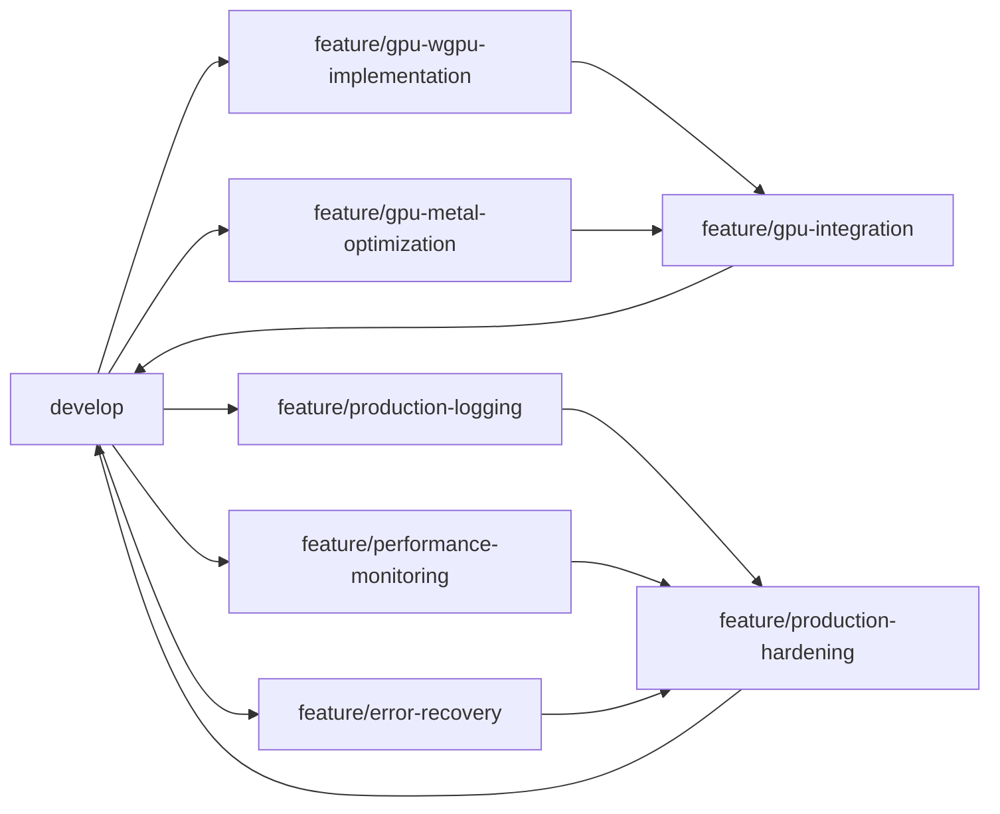
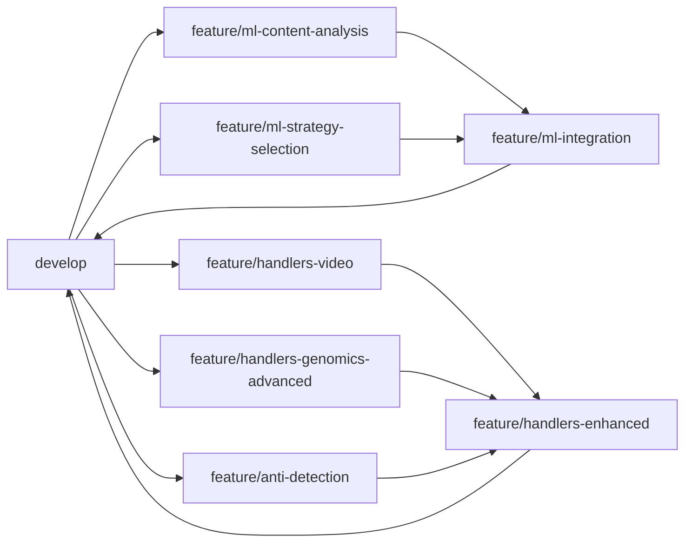

# Stegano 0.2.0 Development Strategy & Branching Model

## Overview

This document outlines the comprehensive development strategy for stegano 0.2.0, including Git branching model, parallel development workflows, CI/CD integration, and team coordination guidelines. The strategy is designed to support simultaneous development of multiple complex features while maintaining code quality and release stability.

## 🌳 Git Branching Strategy

### **Primary Branch Structure**

```
main (production-ready)
├── develop (integration branch)
├── release/0.2.0 (release preparation)
├── feature/gpu-acceleration (Phase 1)
├── feature/ml-optimization (Phase 2)
├── feature/documentation (Phase 3)
├── feature/enterprise-api (Phase 4)
└── hotfix/critical-fixes (emergency fixes)
```

### **Branch Types & Purposes**

#### **1. Master Branch**
- **Purpose**: Production-ready code, always deployable
- **Protection**: 
  - Require pull request reviews (2+ approvers)
  - Require status checks to pass
  - Require up-to-date branches before merging
  - No direct pushes allowed
- **Merge Strategy**: Squash and merge for clean history

#### **2. Develop Branch** 
- **Purpose**: Integration branch for ongoing development
- **Role**: Staging area for feature integration and testing
- **Merge Strategy**: Merge commits to preserve feature branch history
- **CI/CD**: Continuous integration with comprehensive test suite

#### **3. Feature Branches**
- **Naming Convention**: `feature/[phase]-[component]`
- **Examples**:
  - `feature/gpu-wgpu-shaders`
  - `feature/gpu-metal-optimization`
  - `feature/ml-content-analysis`
  - `feature/docs-api-reference`
  - `feature/enterprise-rest-api`

#### **4. Release Branches**
- **Naming Convention**: `release/0.2.0`, `release/0.2.1-rc1`
- **Purpose**: Release preparation, bug fixes, documentation updates
- **Merge Strategy**: Merge to both master and develop

#### **5. Hotfix Branches**
- **Naming Convention**: `hotfix/issue-description`
- **Purpose**: Critical production fixes
- **Merge Strategy**: Fast-forward to master, merge back to develop

## 📋 Parallel Development Workflow

### **Phase-Based Feature Development**

#### **Phase 1: Core Infrastructure (Parallel Tracks)**



**Parallel Development Tracks:**

1. **GPU Acceleration Track**
   - `feature/gpu-wgpu-implementation` - WGPU compute shaders
   - `feature/gpu-metal-optimization` - Metal kernel optimization
   - `feature/gpu-benchmarking` - Performance testing framework
   - `feature/gpu-integration` - Integration and unified interface

2. **Production Track**
   - `feature/production-logging` - Structured logging with telemetry
   - `feature/production-monitoring` - Metrics collection and health checks
   - `feature/production-recovery` - Error recovery and circuit breakers
   - `feature/production-hardening` - Integration and testing

#### **Phase 2: Advanced Features (Parallel Tracks)**



**Parallel Development Tracks:**

1. **ML Optimization Track**
   - `feature/ml-content-analysis` - Content analysis algorithms
   - `feature/ml-strategy-selection` - Adaptive strategy selection
   - `feature/ml-optimization` - Performance optimization
   - `feature/ml-integration` - Integration with existing handlers

2. **Enhanced Handlers Track**
   - `feature/handlers-video` - Video format support (MP4, AVI)
   - `feature/handlers-genomics-advanced` - Advanced genomics processing
   - `feature/handlers-anti-detection` - Anti-detection framework
   - `feature/handlers-enhanced` - Integration and testing

### **Development Workflow Process**

#### **1. Feature Branch Creation**
```bash
# Create feature branch from develop
git checkout develop
git pull origin develop
git checkout -b feature/gpu-wgpu-implementation

# Set up tracking
git push -u origin feature/gpu-wgpu-implementation
```

#### **2. Development Cycle**
```bash
# Regular commits with descriptive messages
git add .
git commit -m "feat(gpu): implement WGPU LSB embedding shader

- Add compute shader for parallel LSB embedding
- Implement buffer management and memory transfer
- Add error handling for GPU device failures
- Include performance benchmarking hooks

Closes #123"

# Push regularly for backup and collaboration
git push origin feature/gpu-wgpu-implementation
```

#### **3. Integration Testing**
```bash
# Sync with develop before PR
git checkout develop
git pull origin develop
git checkout feature/gpu-wgpu-implementation
git merge develop

# Resolve conflicts if any
# Run full test suite
cargo test --all-features
cargo clippy -- -D warnings
cargo fmt --check
```

#### **4. Pull Request Process**
```bash
# Create PR to develop branch
gh pr create --title "feat(gpu): WGPU compute shader implementation" \
             --body "$(cat PR_TEMPLATE.md)" \
             --base develop \
             --head feature/gpu-wgpu-implementation
```

## 🔄 CI/CD Pipeline Integration

### **Automated Workflows**

#### **1. Feature Branch Pipeline**
```yaml
# .github/workflows/feature-branch.yml
name: Feature Branch CI
on:
  push:
    branches: [ 'feature/**' ]
  pull_request:
    branches: [ develop ]

jobs:
  test:
    strategy:
      matrix:
        os: [ubuntu-latest, macos-latest, windows-latest]
        rust: [stable, beta]
    runs-on: ${{ matrix.os }}
    steps:
      - uses: actions/checkout@v3
      - name: Setup Rust
        uses: actions-rs/toolchain@v1
        with:
          toolchain: ${{ matrix.rust }}
      - name: Run tests
        run: cargo test --all-features
      - name: Check formatting
        run: cargo fmt -- --check
      - name: Run clippy
        run: cargo clippy -- -D warnings
      - name: Security audit
        run: cargo audit
```

#### **2. Develop Branch Pipeline**
```yaml
# .github/workflows/develop.yml
name: Develop Integration
on:
  push:
    branches: [ develop ]

jobs:
  integration:
    runs-on: ubuntu-latest
    steps:
      - name: Full test suite
        run: cargo test --all-features --release
      - name: Performance benchmarks
        run: cargo bench
      - name: Documentation build
        run: cargo doc --all-features
      - name: Security scan
        run: cargo audit
      - name: Coverage report
        run: cargo tarpaulin --out xml
```

#### **3. Master Branch Pipeline**
```yaml
# .github/workflows/release.yml
name: Release Pipeline
on:
  push:
    branches: [ master ]
    tags: [ 'v*' ]

jobs:
  release:
    runs-on: ubuntu-latest
    steps:
      - name: Full validation
        run: |
          cargo test --all-features --release
          cargo clippy -- -D warnings
          cargo audit
      - name: Build release artifacts
        run: cargo build --release --all-features
      - name: Create GitHub release
        if: startsWith(github.ref, 'refs/tags/')
        uses: actions/create-release@v1
```

### **Quality Gates**

#### **Feature Branch Requirements**
- ✅ All tests pass on all target platforms
- ✅ Code formatting check (rustfmt)
- ✅ Lint checks pass (clippy)
- ✅ Security audit clean (cargo audit)
- ✅ Documentation builds successfully
- ✅ Performance benchmarks within tolerance

#### **Develop Branch Requirements**
- ✅ Full integration test suite passes
- ✅ Performance regression tests pass
- ✅ Code coverage maintains >95%
- ✅ Documentation coverage 100% for public APIs
- ✅ Security scan passes
- ✅ Memory leak detection clean

#### **Master Branch Requirements**
- ✅ All develop branch requirements
- ✅ Release notes generated
- ✅ Version numbers updated
- ✅ Changelog updated
- ✅ Tagged release created

## 🧪 Integration & Testing Strategy

### **Testing Pyramid**

#### **1. Unit Tests (Base Layer)**
```rust
// Each feature branch includes comprehensive unit tests
#[cfg(test)]
mod tests {
    use super::*;
    
    #[test]
    fn test_gpu_lsb_embedding() {
        // Test individual GPU operations
    }
    
    #[tokio::test]
    async fn test_async_operations() {
        // Test async GPU operations
    }
    
    #[test]
    fn test_error_handling() {
        // Test error conditions and recovery
    }
}
```

#### **2. Integration Tests (Middle Layer)**
```rust
// tests/integration/gpu_integration.rs
#[tokio::test]
async fn test_gpu_cpu_parity() {
    // Ensure GPU and CPU implementations produce identical results
}

#[tokio::test]
async fn test_cross_handler_compatibility() {
    // Test that different handlers work together
}
```

#### **3. End-to-End Tests (Top Layer)**
```rust
// tests/e2e/workflow_tests.rs
#[tokio::test]
async fn test_complete_embedding_workflow() {
    // Test entire embedding and extraction pipeline
}
```

### **Feature Integration Testing**

#### **GPU + ML Integration**
```rust
// tests/integration/gpu_ml_integration.rs
#[tokio::test]
async fn test_ml_driven_gpu_acceleration() {
    // Test ML content analysis with GPU acceleration
    let analyzer = ContentAnalyzer::new();
    let gpu = GpuAccelerator::new().await?;
    
    // Verify ML analysis improves GPU utilization
    let analysis = analyzer.analyze_content(&carrier)?;
    let optimized_result = gpu.ml_optimized_embed(&carrier, &analysis).await?;
    
    assert!(optimized_result.performance_improvement > 1.5);
}
```

#### **Cross-Platform Testing**
```yaml
# Test matrix for comprehensive platform coverage
strategy:
  matrix:
    platform:
      - ubuntu-latest    # Linux x86_64
      - macos-latest     # macOS x86_64
      - macos-latest-xl  # macOS Apple Silicon
      - windows-latest   # Windows x86_64
    features:
      - default
      - gpu
      - metal
      - enterprise
      - all-features
```

## 👥 Development Team Coordination

### **Team Structure & Responsibilities**

#### **1. Core Infrastructure Team**
- **Lead**: GPU acceleration architect
- **Members**: 
  - WGPU compute shader developer
  - Metal optimization specialist
  - Production hardening engineer
- **Focus**: Phase 1 implementation
- **Branches**: `feature/gpu-*`, `feature/production-*`

#### **2. Advanced Features Team**
- **Lead**: ML algorithms architect
- **Members**:
  - Content analysis specialist
  - Video processing engineer
  - Anti-detection researcher
- **Focus**: Phase 2 implementation
- **Branches**: `feature/ml-*`, `feature/handlers-*`

#### **3. Documentation & Integration Team**
- **Lead**: Documentation architect
- **Members**:
  - Technical writer
  - Example developer
  - Integration specialist
- **Focus**: Phase 3 implementation
- **Branches**: `feature/docs-*`, `feature/examples-*`

#### **4. Enterprise Team**
- **Lead**: Enterprise architect
- **Members**:
  - API developer
  - DevOps engineer
  - Monitoring specialist
- **Focus**: Phase 4 implementation
- **Branches**: `feature/enterprise-*`, `feature/api-*`

### **Communication Protocols**

#### **Daily Standups**
- **Schedule**: Daily 9:00 AM UTC
- **Format**: Async in Slack with optional video for complex issues
- **Topics**:
  - Progress on current feature branches
  - Blockers and dependencies
  - Integration points and conflicts

#### **Weekly Integration Meetings**
- **Schedule**: Fridays 2:00 PM UTC
- **Participants**: Team leads + integration team
- **Agenda**:
  - Review develop branch integration status
  - Plan upcoming merges and dependencies
  - Resolve architectural conflicts
  - Update project timeline

#### **Bi-weekly Architecture Reviews**
- **Schedule**: Every other Tuesday 10:00 AM UTC
- **Participants**: All team leads + stakeholders
- **Focus**:
  - Review major architectural decisions
  - Approve cross-team interface changes
  - Resolve technical debt priorities

### **Conflict Resolution Process**

#### **1. Code Conflicts**
```bash
# Standardized conflict resolution process
git checkout feature/my-branch
git fetch origin
git merge origin/develop

# If conflicts occur:
# 1. Resolve conflicts manually
# 2. Run full test suite
# 3. Get peer review for conflict resolution
# 4. Document resolution rationale in commit message
```

#### **2. Architectural Conflicts**
1. **Document Issue**: Create GitHub issue with `conflict` label
2. **Stakeholder Review**: Include affected team leads
3. **Decision Timeline**: 48-hour maximum for resolution
4. **Implementation**: Update affected branches consistently

#### **3. Resource Conflicts**
1. **Shared Dependencies**: Use feature flags to enable parallel development
2. **Test Resources**: Time-box CI/CD usage during peak hours
3. **Review Bandwidth**: Rotate review responsibilities across teams

## 📅 Release Coordination

### **Feature Freeze Timeline**

```
Week 1-4:   Phase 1 Feature Development
Week 5:     Phase 1 Feature Freeze & Integration
Week 6-8:   Phase 2 Feature Development
Week 9:     Phase 2 Feature Freeze & Integration
Week 10-11: Phase 3 Feature Development
Week 12:    Phase 3 Feature Freeze & Integration
Week 13-14: Phase 4 Feature Development
Week 15:    Phase 4 Feature Freeze & Integration
Week 16:    Release Candidate & Final Testing
```

### **Integration Checkpoints**

#### **Phase 1 Integration (Week 5)**
- [ ] GPU acceleration fully functional
- [ ] Production hardening integrated
- [ ] Performance benchmarks meet targets
- [ ] All Phase 1 tests passing

#### **Phase 2 Integration (Week 9)**
- [ ] ML optimization integrated with GPU
- [ ] Enhanced handlers compatible with existing code
- [ ] Anti-detection framework operational
- [ ] Cross-phase integration verified

#### **Phase 3 Integration (Week 12)**
- [ ] Documentation complete and accurate
- [ ] Examples demonstrate all features
- [ ] Integration guides validated
- [ ] API documentation 100% coverage

#### **Phase 4 Integration (Week 15)**
- [ ] Enterprise features production-ready
- [ ] Monitoring and APIs fully functional
- [ ] Container deployment tested
- [ ] Performance under load verified

### **Release Branch Management**

#### **Release Preparation**
```bash
# Create release branch from develop
git checkout develop
git pull origin develop
git checkout -b release/0.2.0

# Final preparations
- Update version numbers
- Generate changelog
- Update documentation
- Run full test suite
- Performance validation
```

#### **Release Candidate Process**
```bash
# Tag release candidate
git tag -a v0.2.0-rc1 -m "Release candidate 1 for v0.2.0"
git push origin v0.2.0-rc1

# Deploy to staging environment
# Run acceptance tests
# Gather feedback from stakeholders
```

#### **Final Release**
```bash
# Merge to master
git checkout master
git merge release/0.2.0

# Tag final release
git tag -a v0.2.0 -m "Release v0.2.0: Enterprise-grade steganography"
git push origin v0.2.0

# Merge back to develop
git checkout develop
git merge master
```

## 🛠️ Development Tools & Setup

### **Required Tools**
```bash
# Rust toolchain
rustup default stable
rustup component add clippy rustfmt

# Development tools
cargo install cargo-audit cargo-tarpaulin cargo-watch cargo-expand

# Git tools
gh auth login  # GitHub CLI for PR management
git config --global core.autocrlf input  # Cross-platform compatibility
```

### **IDE Configuration**

#### **VS Code Extensions**
- `rust-analyzer` - Rust language support
- `GitLens` - Git integration and history
- `Better TOML` - Cargo.toml syntax highlighting
- `Error Lens` - Inline error display

#### **Development Scripts**
```bash
# scripts/dev-setup.sh
#!/bin/bash
set -e

echo "Setting up stegano development environment..."

# Install required tools
cargo install cargo-audit cargo-tarpaulin cargo-watch

# Setup git hooks
cp scripts/pre-commit .git/hooks/
chmod +x .git/hooks/pre-commit

# Create local config
cp config/development.toml.example config/development.toml

echo "Development environment ready!"
```

## 📊 Success Metrics & Monitoring

### **Development Velocity Metrics**
- **Commit Frequency**: Target 2-3 commits per developer per day
- **PR Cycle Time**: Target <48 hours from creation to merge
- **Build Success Rate**: Target >95% first-time build success
- **Test Coverage**: Maintain >95% throughout development

### **Quality Metrics**
- **Defect Rate**: Target <1 critical bug per 1000 lines of code
- **Performance Regression**: Zero tolerance for >5% performance loss
- **Security Issues**: Zero tolerance for security vulnerabilities
- **Documentation Coverage**: 100% for public APIs

### **Integration Metrics**
- **Merge Conflict Rate**: Target <10% of PRs have conflicts
- **Integration Test Success**: Target >98% success rate
- **Cross-Platform Compatibility**: 100% test pass rate on all platforms
- **Feature Flag Usage**: Track feature adoption and stability

## 🔒 Security & Compliance

### **Secure Development Practices**
- **Code Review**: All code reviewed by 2+ developers
- **Security Scanning**: Automated dependency and code security scans
- **Secrets Management**: No secrets in code, use environment variables
- **Access Control**: Branch protection and signed commits required

### **Compliance Considerations**
- **License Compatibility**: Verify all dependencies have compatible licenses
- **Export Controls**: Consider cryptographic export restrictions
- **Data Privacy**: Ensure test data doesn't contain sensitive information
- **Audit Trail**: Maintain comprehensive development audit logs

## 🚀 Conclusion

This development strategy provides a comprehensive framework for managing the complex 0.2.0 implementation while maintaining code quality, team coordination, and release stability. The parallel development approach enables efficient resource utilization while the structured branching model ensures clean integration and deployment.

**Key Success Factors:**
1. **Clear branch ownership** and responsibilities
2. **Automated quality gates** at every level
3. **Regular integration checkpoints** to catch issues early
4. **Comprehensive testing strategy** across all development phases
5. **Effective team communication** and conflict resolution

The strategy balances development velocity with code quality, enabling the team to deliver the ambitious 0.2.0 feature set on schedule while maintaining the high standards established in 0.1.1.

---

*Development strategy version: 1.0*  
*Target implementation: stegano v0.2.0*  
*Estimated timeline: 16 weeks with parallel development*